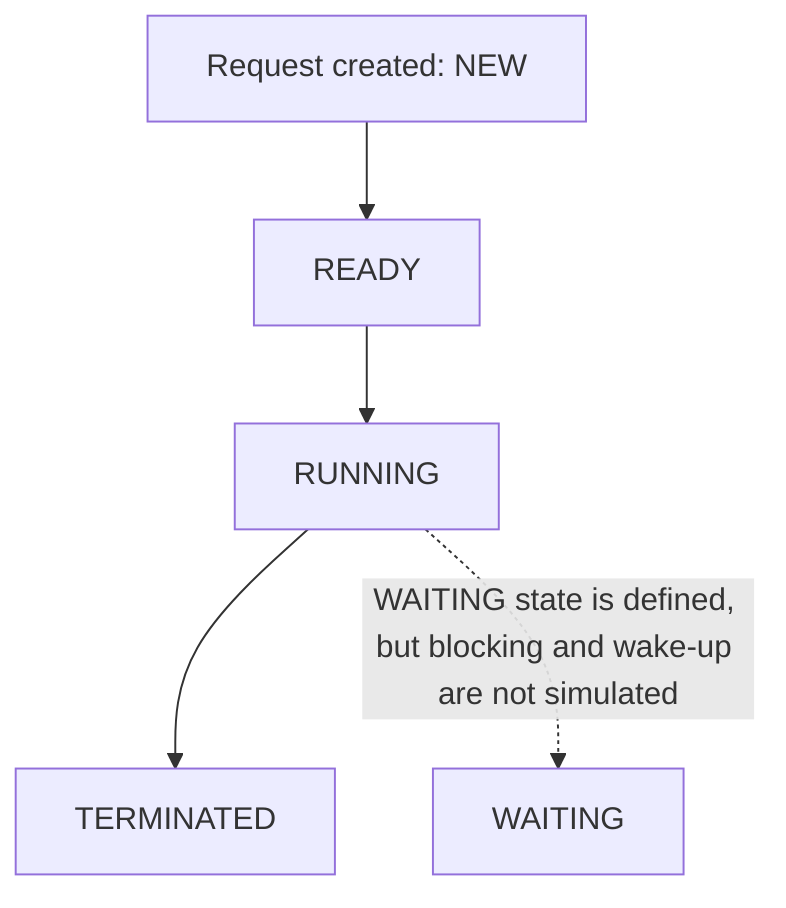

# Phase 1 Evidence Pack — OS PBL

**Project:** Integrated National Citizen Services Platform  
**Course:** Operating System (CCSE0303A)  
**Scope:** Phase 1 only — Modules 1 and 2  
**Rule:** This document provides diagrams and a record template. It does not claim that unperformed Linux activities or screenshots exist.

## Evidence A — Simulated request lifecycle

The diagram describes the educational model in the code. It is not a diagram of the host operating system's actual kernel scheduler.



Current implementation: `run_fcfs()` moves each request through READY, RUNNING and TERMINATED. WAITING is a defined state only; no transition into or out of WAITING is currently implemented.

## Evidence B — FCFS Gantt chart for the existing demo

All four demo requests have arrival time 0. Their burst times are 3, 2, 4 and 1 simulated time units.

```text
Time:      0       3       5               9   10
           | REQ-1 | REQ-2 |    REQ-3      |REQ4|
           |-------|-------|---------------|----|
CPU:       Certificate Identity Grievance   Tax
```

| Request | Arrival | Burst | Start | Finish | Waiting | Turnaround |
|---|---:|---:|---:|---:|---:|---:|
| REQ-001 — Certificate | 0 | 3 | 0 | 3 | 0 | 3 |
| REQ-002 — Identity | 0 | 2 | 3 | 5 | 3 | 5 |
| REQ-003 — Grievance | 0 | 4 | 5 | 9 | 5 | 9 |
| REQ-004 — Tax | 0 | 1 | 9 | 10 | 9 | 10 |

These numbers match the user's successful CLI output on 2026-10-20. Times are simulated units, not wall-clock seconds.

## Evidence C — Formula reference

- Finish time = start time + burst time
- Turnaround time = finish time − arrival time
- Waiting time = start time − arrival time, for this non-preemptive single-burst model
- Equivalently, waiting time = turnaround time − burst time

Example for REQ-003:
- Finish = 5 + 4 = 9
- Turnaround = 9 − 0 = 9
- Waiting = 5 − 0 = 5

## Evidence D — Module 1 Linux CLI practical record

The current verified environment is Windows PowerShell, not Linux. Fill this section only after actually running the commands in a Linux environment (for example, a Linux lab machine or WSL).

| Command | Purpose | Actual result / evidence |
|---|---|---|
| `pwd` | Identify working directory | Pending Linux run |
| `ls` | List project files | Pending Linux run |
| `python3 --version` | Check Python version | Pending Linux run |
| `python3 -m unittest discover -s tests -v` | Run tests | Pending Linux run |
| `bash scripts/phase1_check.sh` | Run shell automation | Pending Linux run |

Do not replace “Pending Linux run” with a guessed result. Save a screenshot or terminal transcript after the commands are genuinely run.

## Evidence E — Verified Windows practical record

On 2026-10-20, the user ran:

```powershell
powershell -ExecutionPolicy Bypass -File .\scripts\phase1_check.ps1
```

Observed result:
- Python 3.14.7 reported.
- All six required files were found.
- All 12 unit tests passed in 0.044 seconds.
- CLI demo processed REQ-001 through REQ-004 and saved `data\demo_requests.json`.
- Script ended with `Phase 1 project check completed successfully.`

This is genuine Windows verification. It does not prove the Bash script was executed on Linux.

## Evidence F — Current scope boundaries

Implemented and verified:
- Python request model with simulated lifecycle states and PCB-like timing metadata.
- FCFS scheduling simulation.
- JSON persistence for synthetic demonstration data.
- CLI output and automated tests.
- Windows PowerShell project check.

Not implemented:
- Actual kernel/system-call implementation.
- Linux execution evidence.
- SJF, SRTF, Priority, Round Robin, multilevel queue or feedback queue algorithms.
- Real concurrent threads, locks/semaphores, blocking/wakeup, or deadlock experiments.
- Real government service integration.

For Phase 1, explain syllabus topics accurately and demonstrate only what the approved requirements need. Do not add unneeded algorithms just to increase code size.

## Before using this pack in a report

1. Check the official Phase 1 report rubric and course instructor's requirements.
2. Capture actual screenshots of the Windows verification output and application output if screenshots are required.
3. Run the Linux commands only if Linux practical evidence is required; record genuine output.
4. Keep submitted Report 1 unchanged. Use this file as supporting working evidence, not as a replacement for the submitted report.
